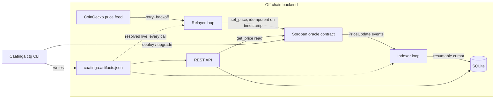

# Caatinga Price Oracle

A backend relayer + event indexer + REST API for a Soroban price-oracle
contract, built for the [GrantFox × NearX Caatinga Bounties](https://bounties.grantfox.xyz/events/caatinga-bounties)
hackathon, **Backend, Automation & Agents** lane.

It deploys a contract via [Caatinga](https://github.com/Dione-b/caatinga)
(a deployment orchestrator + versioned artifact manager for Soroban),
resolves that contract's ID exclusively from Caatinga's own
`caatinga.artifacts.json` -- never hardcoded -- and keeps running
correctly across both of Caatinga's upgrade strategies (in-place and
redeploy) with no restart.

> New to this? You don't need any Soroban/Stellar background to run it --
> follow [Setup](#setup) top to bottom. Every command is copy-pasteable.

## What's deployed, live, right now

| | |
|---|---|
| Network | Stellar **testnet** |
| Contract | `oracle` ([source](contracts/oracle/src/lib.rs)) |
| Resolve contract ID | always from [`caatinga.artifacts.json`](caatinga.artifacts.json), never hardcoded (see [`backend/src/lib/artifacts.ts`](backend/src/lib/artifacts.ts)) |

The exact contract ID changes every time the contract is redeployed
(that's the point -- see [Upgrades](#upgrades-demonstrated-live)); check
`caatinga.artifacts.json` in this repo for the current one, or hit the
running backend's `GET /artifacts`.

## Architecture



- **Contract** (`contracts/oracle`): admin-gated `set_price`/`get_price`,
  emits a `PriceUpdate` event on every applied write, idempotent on
  `timestamp` (a stale resubmission is a safe no-op, not an overwrite or
  an error), and exposes `upgrade(new_wasm_hash)` for in-place upgrades.
- **Relayer** (`backend/src/relayer.ts`): polls CoinGecko for XLM/BTC
  USD prices, checks the on-chain timestamp first (skips a redundant
  write), submits with retry/backoff, and resolves the contract ID fresh
  from artifacts on every single call.
- **Indexer** (`backend/src/indexer.ts`): polls Soroban RPC `getEvents`
  for `PriceUpdate`, using the generated binding's own
  `priceUpdateEventFilter()`/`parseEvent()` helpers, and records history
  into SQLite with a resumable per-contract-id cursor.
- **API** (`backend/src/api.ts`): `GET /health`, `GET /artifacts`,
  `GET /prices/:asset`, `GET /prices/:asset/history`.

## Repo layout

```
caatinga.config.ts          Caatinga config: contracts, networks, postDeploy hook
caatinga.artifacts.json     Caatinga-managed, versioned deploy record (source of truth)
contracts/oracle/           the Soroban contract (Rust)
backend/                    the Node/TypeScript backend service
  src/relayer.ts            price-feed -> on-chain submission loop
  src/indexer.ts             on-chain events -> SQLite loop
  src/api.ts                 REST API
  src/lib/artifacts.ts       resolves + watches caatinga.artifacts.json
  src/lib/signer.ts          server-side transaction signer
  src/lib/retry.ts           retry/backoff + health tracking
  src/lib/errors.ts          CAATINGA_* error classification
  test/                      vitest unit tests
docs/
  security.md                key-management writeup
  caatinga-friction-log.md   detailed friction log (see below)
```

## Setup

### Prerequisites

- Node.js 22+
- Rust + the `wasm32v1-none` target (`rustup target add wasm32v1-none`)
- [Stellar CLI](https://developers.stellar.org/docs/tools/cli/install-cli) 23.0.0+ (`stellar --version`)

```bash
npm install -g @caatinga/cli@3.14.0
```

### 1. Create and fund a signing identity

This is the account that deploys the contract and becomes its admin.

```bash
stellar keys generate alice --network testnet --fund
stellar keys address alice   # prints its G... address, for reference
```

If `--fund` reports success but the account isn't actually funded yet
(we hit this -- see [friction log #8](docs/caatinga-friction-log.md)),
fund it directly:

```bash
curl "https://friendbot.stellar.org/?addr=$(stellar keys address alice)"
```

### 2. Deploy the contract

```bash
npm install            # installs @caatinga/cli locally too
npx ctg doctor --network testnet --source alice
npx ctg build oracle
npx ctg deploy --network testnet --source alice   # deploys + runs postDeploy initialize
```

This writes the deployed contract's ID into `caatinga.artifacts.json`.
Nothing downstream ever reads a contract ID from anywhere else.

### 3. Generate TypeScript bindings for the backend

```bash
npx ctg generate oracle --network testnet
```

(If this fails with a bare `fetch failed` and you're behind a proxy, see
[friction log #3](docs/caatinga-friction-log.md) -- set
`NODE_USE_ENV_PROXY=1` and retry.)

### 4. Configure and run the backend

```bash
cd backend
npm install
cp .env.example .env
```

Edit `.env`:
- `ORACLE_SIGNER_SECRET` -- the secret key for the identity from step 1
  (`stellar keys show alice`). See [docs/security.md](docs/security.md)
  for why this is safe for a testnet demo and what to do differently in
  production.
- Everything else has a sensible default for testnet.

```bash
npm run dev
```

You should see structured JSON logs: the resolved contract ID, then
periodic price submissions and indexed events. Try it:

```bash
curl localhost:8080/health
curl localhost:8080/artifacts
curl localhost:8080/prices/XLM
curl "localhost:8080/prices/XLM/history?limit=10"
```

### Running tests

```bash
# Contract (Rust)
cargo test --manifest-path contracts/oracle/Cargo.toml

# Backend (TypeScript)
cd backend && npm test        # vitest: retry/backoff, idempotent DB writes,
                               # error classification, live artifact resolution
npm run typecheck
```

## Upgrades, demonstrated live

Both of Caatinga's upgrade strategies were exercised against the running
backend, with zero restarts and zero code/config changes to pick up
either one:

1. **Redeploy** (`ctg deploy oracle --upgrade`) -- produces a **new**
   contract ID. The backend's artifact watcher
   (`backend/src/lib/artifacts.ts`) detected the change within one poll
   cycle and logged `contract REDEPLOYED to a new instance -- switching
   automatically, no restart needed`, then resumed submitting prices and
   indexing events against the new ID, confirmed via `GET /artifacts` and
   `GET /health` reflecting the new ID live.
2. **In-place** (`ctg upgrade oracle`) -- same contract ID, new WASM.
   The backend logged `contract WASM upgraded in-place -- same contract
   ID, new logic takes effect immediately`. The upgrade itself added a
   price-bounds check (`PriceOutOfBounds`) and an admin-rotation method
   (`set_admin`, for key rotation without redeployment); a price above
   the new bound was confirmed rejected on-chain immediately after.

Reproduce it yourself: start the backend (`npm run dev`), then in another
terminal run `npx ctg deploy oracle --upgrade --network testnet --source
alice` (remember to re-run the contract's `initialize` for the new
instance -- a redeploy doesn't carry that over) or
`npx ctg upgrade oracle --network testnet --source alice`, and watch the
backend's own logs.

## Failure handling, demonstrated live

Rather than mock failures, we cut off real network access (via this
session's egress allowlist) to the price feed and to Soroban RPC while
the backend was running against live testnet, and watched it recover
without intervention:

- **Price-feed outage:** `GET /health` flipped to
  `{"status":"degraded","subsystems":{"priceFeed":{"healthy":false,...}}}`
  after exponential-backoff retries were exhausted for that tick; the
  relayer loop logged the failure and simply tried again next tick rather
  than crash-looping. Once access was restored, the next tick succeeded
  and `/health` returned to `"ok"` automatically.
- **Soroban RPC outage:** both the indexer and relayer failed cleanly for
  several ticks (`fetch failed`, retried with backoff), `/health` showed
  `indexer` degraded with a `consecutiveFailures` counter, and -- once
  restored -- both resumed on the next scheduled tick with no restart,
  no duplicate on-chain submissions, and no lost indexer position (the
  cursor is stored per-contract-id in SQLite).

**Idempotency**, specifically: `set_price` only applies a write if the
submitted `timestamp` is strictly newer than the one on-chain (see
`contracts/oracle/src/lib.rs`); a retried submission after a timeout is
therefore always safe to resend. The indexer's `price_history` table has
a `UNIQUE(asset, contract_id, timestamp)` constraint, so re-scanning an
overlapping ledger range on resume never double-counts a row (see
`backend/test/db.test.ts`).

## Security / key management

See [docs/security.md](docs/security.md): where the signing key lives,
why it's never committed or logged, and how to rotate it in production
using the v2 contract's `set_admin` method.

## Caatinga friction log

See [docs/caatinga-friction-log.md](docs/caatinga-friction-log.md) for
the detailed, specific feedback -- what worked well, and eight concrete
things that cost real debugging time, each with repro steps and a
suggested fix. The headline one: `ctg upgrade`'s fixed CLI invocation
means an admin-gated `upgrade()` function's signature is permanently
locked in at first deploy, with no recovery short of a full redeploy if
you get it wrong (we did, the first time).

## Known limitations (scope, not bugs)

- The indexer backfills at most 500 ledgers on a cold start (public RPC
  providers only retain recent history for `getEvents`); a full
  historical backfill beyond that needs an archival data source.
- The indexer polls a single page (`limit: 100`) per tick rather than
  paginating with the RPC cursor; fine for this demo's event volume, not
  tuned for high-throughput production use.
- The relayer refreshes the on-chain timestamp every tick regardless of
  whether the USD price actually changed (a deliberate oracle "heartbeat"
  design, not a bug) -- see the idempotency note above for what *is*
  guarded against.

## License

MIT
